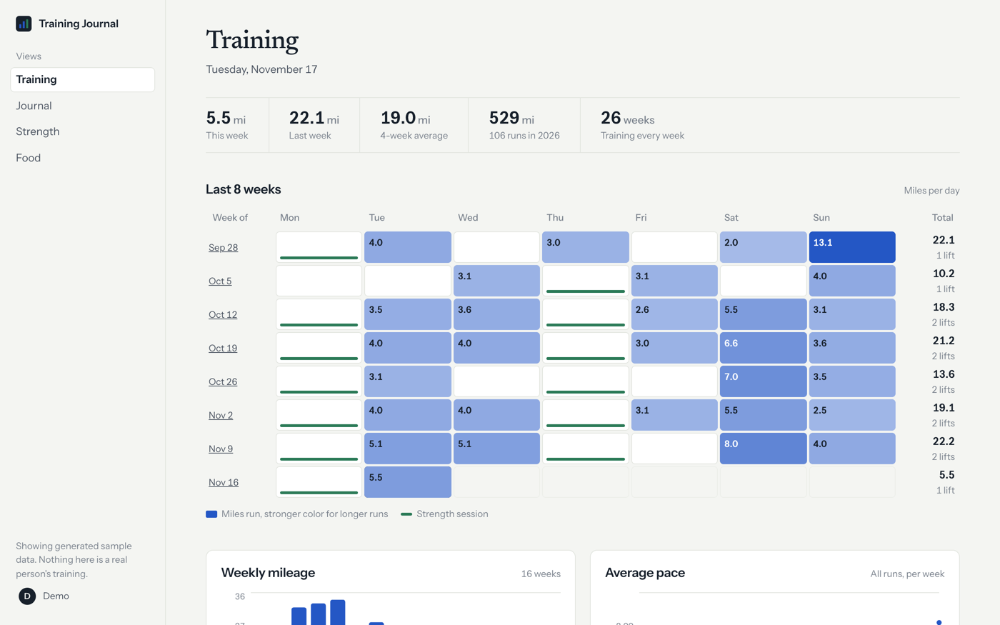

# Training Journal

A training log for running and lifting. Each run or strength session is a journal entry with notes, and the dashboard turns them into weekly mileage, pace trends, best efforts and lift progression. Link a Garmin account and new runs come in on their own every few hours. On a phone it installs to the home screen and works like an app.



## Try it

You need Docker. No keys.

```sh
docker compose up --build
```

Open http://localhost:4000 and choose **Try the demo**. The demo account is read-only and holds about six months of generated training: a build to a half marathon, a recovery week, and a second build, with strength sessions twice a week. None of it is real data. To keep your own journal, choose **Create an account** instead.

## What it does

- **Journal:** every entry, grouped by week with weekly totals. Filter by runs or strength, and search titles, notes, tags and exercise names.
- **Entries:** open one and edit it in place. Changes save as you type. Runs have distance, time, pace, heart rate and effort. Strength sessions have exercises with sets of reps and weight, and show each set's estimated max.
- **Training:** this week against recent weeks, an 8-week log of daily miles with lifting days marked, weekly mileage, average pace by week, and best efforts at 1 mile, 5K, 10K, half and full marathon.
- **Strength:** estimated one-rep max over time for each lift (Epley formula), with the top set from each session.
- **Accounts:** sign up with an email and password. Each account sees only its own entries.
- **Garmin sync:** link your Garmin account under Settings and the server pulls new runs and strength sessions every 6 hours (or when you tap Sync now). Entries are matched on Garmin's activity ID, so a sync never duplicates entries or overwrites the notes you wrote.
- **On your phone:** a bottom tab bar, a quick Log button, and a web app manifest, so Add to Home Screen gives it its own icon and opens it full screen.

| Journal | Strength |
| --- | --- |
|  |  |

## How it's built

```
web/      React + TypeScript (Vite), Recharts. Served by nginx, which proxies /api.
api/      Spring Boot 3 (Java 17) REST API on MongoDB.
loader/   Python: the garmin-sync service the API calls, plus a one-off import script.
```

```
Browser / phone ──► nginx (web) ──► /api/* ──► Spring Boot ──► MongoDB (users, activities, sessions)
                                                   │  every 6 h, per linked account
                                                   ▼
                                       garmin-sync (Python, internal only) ──► Garmin Connect
```

API endpoints (OpenAPI docs at http://localhost:4000/api/docs):

| Method | Path | |
| --- | --- | --- |
| POST | `/api/auth/signup`, `/api/auth/login`, `/api/auth/logout`, `/api/auth/demo` | Accounts and sessions |
| GET | `/api/auth/me` | The signed-in account, or 401 |
| GET, POST, DELETE | `/api/garmin`, `/api/garmin/link`, `/api/garmin/link/code`, `/api/garmin/sync` | Garmin status, linking (with Garmin's emailed code), sync now, unlink |
| GET | `/api/activities?type=&from=&to=&q=&tag=` | List entries, newest first. `q` searches titles, notes, tags and exercise names. |
| GET, PUT, DELETE | `/api/activities/{id}` | Read, replace or delete one entry |
| POST | `/api/activities` | Create an entry |
| POST | `/api/activities/import` | Bulk upsert by `externalId` (used by the import script) |
| GET | `/api/stats?weeks=16&days=140` | Weekly totals, best efforts, lift progression and daily miles |

Every endpoint except `/api/auth/*` needs a signed-in session, and entries are always filtered by the session's account. Distances and times are stored as numbers (miles, seconds); pace and volume are worked out from them. Stats are computed in plain Java over the entry list (`StatsCalculator`), which keeps them easy to unit test.

## Garmin sync

Garmin has no public API for personal accounts, so the `garmin-sync` service signs in the way the Garmin Connect app does (with the [garminconnect](https://github.com/cyberjunky/python-garminconnect) library) and returns Garmin's login token to the API.

1. Set `GARMIN_TOKEN_KEY` in `.env` (`openssl rand -base64 32`). Linking is off without it.
2. In the app, open Settings and enter your Garmin email and password, plus the code Garmin sends if you use two-step sign-in.
3. The first sync reads the past year. After that the API syncs every linked account every 6 hours (`GARMIN_SYNC_EVERY`).

How the login is handled:

- The Garmin password goes to Garmin once and is never stored or logged.
- Garmin's token is stored encrypted with AES-256-GCM. The key lives only in the environment, and each token is tied to its account, so a token copied onto another account won't decrypt.
- `garmin-sync` has no published port. Only the API can reach it, inside the Docker network.
- If Garmin rejects the token later, syncing stops for that account and Settings asks you to link again.

Only summary numbers are imported. GPS tracks, start locations and Garmin's activity names, which usually include the city, are left out. Strength sessions come in without sets, so you add those in the journal.

For a one-off import from the command line, `loader/garmin_import.py --dry-run` prints what it would import, and without `--dry-run` it signs in to the journal and sends it.

## Accounts and sessions

- Passwords are hashed with bcrypt. After 8 wrong passwords, that email is locked for 15 minutes.
- Sessions are HttpOnly cookies stored in MongoDB (Spring Session) and last 30 days, so a phone stays signed in.
- Every POST, PUT and DELETE needs a CSRF token (double-submit cookie).
- The demo account can read but not write.
- Entries saved before accounts existed belong to the first account created on that database.

## Using it on your phone

The app is a normal website, so a phone needs a way to reach the computer running it. [Tailscale](https://tailscale.com) is the simplest private option. Install it on the computer and the phone, sign in to the same account on both, then on the computer run:

```sh
tailscale serve --bg 4000
```

That gives the app an HTTPS address on your tailnet, such as `https://your-mac.your-tailnet.ts.net`, which only your own devices can open. Open it in Safari or Chrome on the phone and choose Add to Home Screen.

## Running the pieces separately

```sh
docker compose up mongo -d                  # or point MONGODB_URI at your own MongoDB
cd api && DEMO_DATA=true SPRING_DATA_MONGODB_URI=mongodb://localhost:27017 ./mvnw spring-boot:run
cd web && npm install && npm run dev       # http://localhost:5173, proxies /api to :8080
```

For local runs, expose Mongo with `ports: ["127.0.0.1:27017:27017"]` in a `docker-compose.override.yml`. To use MongoDB Atlas, set `MONGODB_URI` in `.env` for Compose, or `SPRING_DATA_MONGODB_URI` when running the API directly. An `application-secrets.properties` file next to `application.properties` also works and is gitignored. It's excluded from the Docker build.

## Tests

```sh
cd api && ./mvnw verify          # unit tests + API tests against MongoDB via Testcontainers (needs Docker)
cd web && npm test
cd loader && pytest
```

CI runs all three plus a `docker compose up` smoke test that signs in to the demo through nginx.

## Background

This started in summer 2025 as a script that pulled my runs from Garmin and a small Spring Boot API with Atlas Search on top. In 2026 I rebuilt it into a journal: numeric run data instead of formatted strings, strength sessions, a frontend, sample data, Docker Compose and tests.
