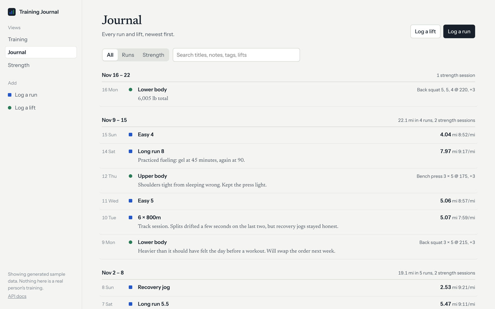
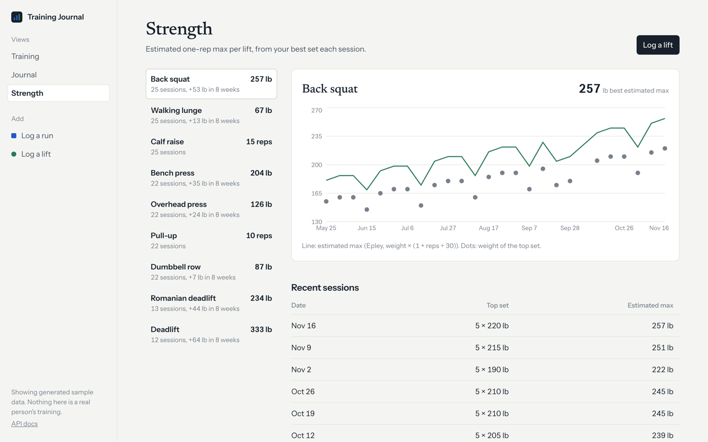
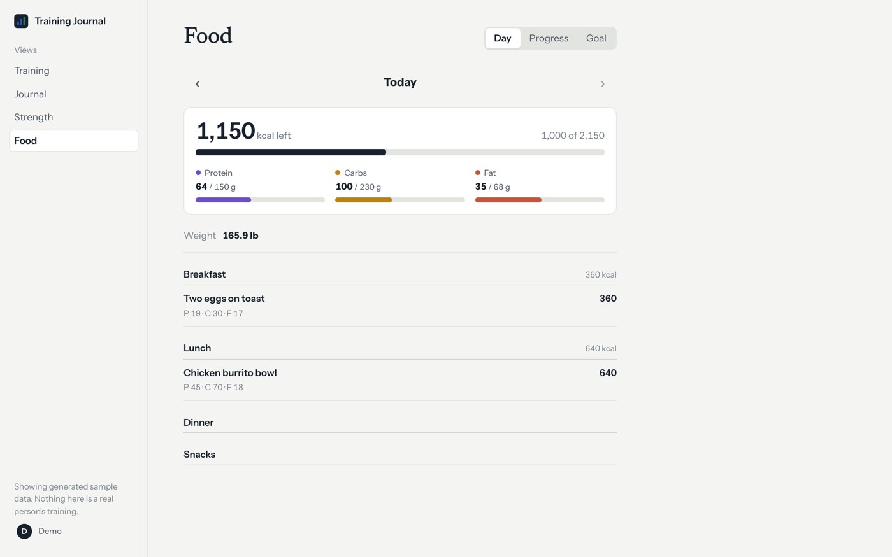
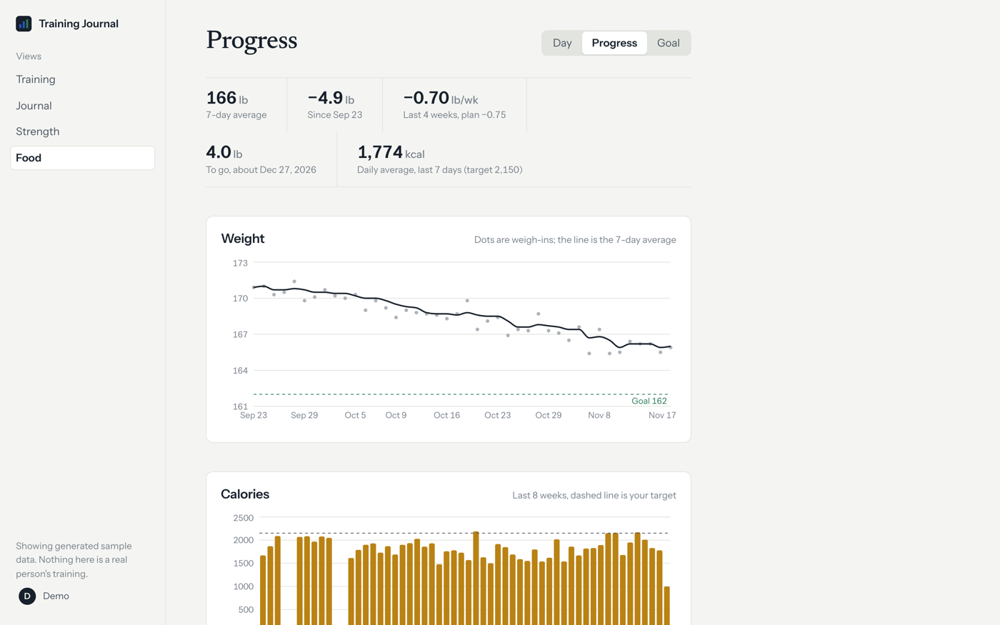
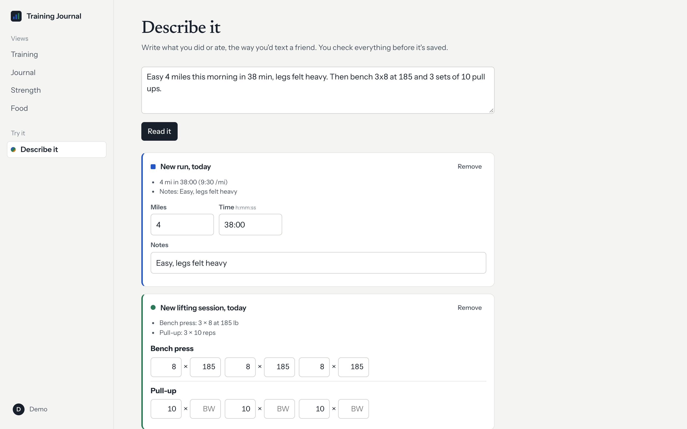
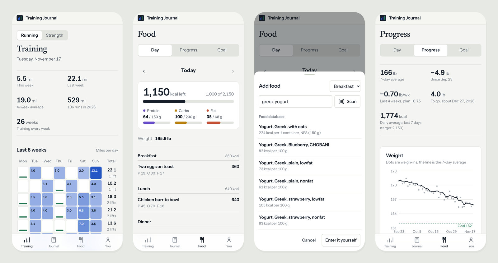

# Training Journal

A training log for running, lifting and eating. Each run or strength session is a journal entry with notes, which you can also just describe in a sentence, and the dashboard turns them into weekly mileage, pace trends, best efforts and lift progression. Link a Garmin account and new runs come in on their own every few hours. On a phone it installs to the home screen and works like an app.


## Try it

You need Docker. No keys.

```sh
docker compose up --build
```

Open http://localhost:4000 and choose **Try the demo**. The demo account is read-only and holds about six months of generated training: a build to a half marathon, a recovery week, and a second build, with strength sessions twice a week. None of it is real data. To keep your own journal, choose **Create an account** instead.

## What it does

- **Journal:** every entry, grouped by week with weekly totals. Filter by runs or strength, and search titles, notes, tags and exercise names.
- **Entries:** open one and edit it in place. Changes save as you type. Runs have distance, time, pace, heart rate and effort. Strength sessions have exercises with sets of reps and weight, and show each set's estimated max.
- **Training:** this week against recent weeks, an 8-week log of daily miles with lifting days marked, weekly mileage, average pace by week, and best efforts at 1 mile, 5K, 10K, half and full marathon.
- **Strength:** estimated one-rep max over time for each lift (Epley formula), with the top set from each session.
- **Food:** log what you eat by meal, with calories, protein, carbs and fat per serving. Search a food database, or scan a package's barcode with the phone's camera, and pick an amount (a serving, a cup, grams). Foods you've had before come back in one tap. Each day shows what's left against your targets, and you can log your weight.
- **Goals and progress:** set a goal to lose, maintain or gain, with a target weight and pace. A calculator suggests daily calories and macros (Mifflin-St Jeor for maintenance, 500 kcal a day per pound a week, protein by body weight). It won't suggest losing more than 1% of body weight a week or eating below 1,200/1,500 kcal. Progress shows weigh-ins with a 7-day average, your actual rate over the last 4 weeks, a projected date, and daily calories against the target.
- **Accounts:** sign up with an email and password. Each account sees only its own entries.
- **Garmin sync:** link your Garmin account under Settings and the server pulls new runs and strength sessions every 6 hours (or when you tap Sync now). Entries are matched on Garmin's activity ID, so a sync never duplicates entries or overwrites the notes you wrote.
- **Describe it:** type what you did the way you'd text a friend ("easy 4 miles, legs heavy, then bench 3x8 at 185, lunch was a turkey sandwich") and it drafts the entries: a run, sets added to today's lifting session, a meal with its macros. "The last bench set was only 6 reps" changes the set that's already there. You check and edit every draft before anything is saved. By default it runs on a local model, so messages never leave your computer.
- **On your phone:** a bottom tab bar, a quick Log button, and a web app manifest, so Add to Home Screen gives it its own icon and opens it full screen.

| Journal | Strength |
| --- | --- |
|  |  |
| **Food** | **Progress** |
|  |  |

Describe it turns a sentence into drafts to check. Here "pull ups" was matched to the Pull-up the journal already tracks:



On a phone it has a bottom tab bar and installs to the home screen:



## How it's built

```
web/      React + TypeScript (Vite), Recharts. Served by nginx, which proxies /api.
api/      Spring Boot 3 (Java 17) REST API on MongoDB.
loader/   Python: the garmin-sync service the API calls, plus a one-off import script.
```

```
Browser / phone ──► nginx (web) ──► /api/* ──► Spring Boot ──► MongoDB (accounts, entries, food, sessions)
                                                    │
               ┌────────────────────────────────────┼─────────────────────────────┐
               ▼ every 6 h, per linked account      ▼ food search                 ▼ Describe it
   garmin-sync (Python, internal only)     USDA, Open Food Facts     Ollama on the host (or Claude)
               │
               ▼
        Garmin Connect
```

The parts with rules in them (weekly stats, lift progression, the calorie calculator, weight progress, turning a parsed message into drafts) are plain Java over lists, with unit tests for each. The API tests run against a real MongoDB in Testcontainers.

More detail:

- [Setup and configuration](docs/setup.md): Garmin sync, food search keys, the local model for Describe it, using it on a phone, and every setting.
- [API](docs/api.md): endpoints, sessions and CSRF, calling it from a script.
- [Development](docs/development.md): running each piece on its own, tests, where the code lives.

## Background

This started in summer 2025 as a script that pulled my runs from Garmin and a small Spring Boot API with Atlas Search on top. In 2026 I rebuilt it into a journal: numeric run data instead of formatted strings, strength sessions, a frontend, sample data, Docker Compose and tests.
